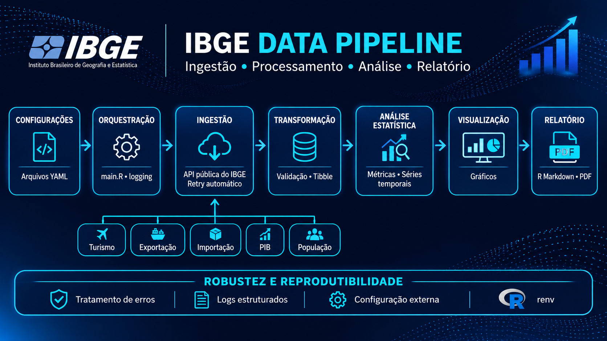

<p align="center">
  <strong>Data Engineering • Statistical Analysis • Data Reporting</strong>
</p>

<p align="center">
  Pipeline de dados desenvolvido em R para ingestão, processamento, análise estatística e geração automatizada de relatórios a partir da API pública do IBGE.
</p>

<p align="center">
  
  
  
  
  
</p>

## 1. Visão Geral

O IBGE Data Pipeline é um projeto de Engenharia de Dados desenvolvido em R, com o objetivo de demonstrar a construção de um fluxo modular e resiliente de coleta, transformação, análise e apresentação de dados estatísticos provenientes da API pública do Instituto Brasileiro de Geografia e Estatística (IBGE).

A solução contempla diferentes etapas do ciclo de vida dos dados, desde a comunicação com a API até a disponibilização dos resultados em um relatório analítico em PDF.

O projeto aplica conceitos e boas práticas de:

* Engenharia de Dados;
* Integração com APIs REST;
* Processamento e transformação de dados;
* Análise estatística de séries temporais;
* Modularização e separação de responsabilidades;
* Tratamento de exceções e recuperação de falhas;
* Logging estruturado;
* Gerenciamento externo de configurações;
* Reprodutibilidade de ambientes.

### Principais funcionalidades

| Funcionalidade | Descrição |
| -------------- | --------- |
| Data Ingestion | Consumo de indicadores da API do IBGE |
| Data Processing | Validação, transformação e padronização |
| Statistical Analysis | Cálculo de métricas estatísticas |
| Data Visualization | Preparação e geração de gráficos |
| Fault Tolerance | Retry automático e tratamento de falhas |
| Logging | Registro estruturado das operações |
| Reporting | Geração de relatórios em PDF |

## 2. Arquitetura e Fluxo de Dados

A arquitetura foi organizada em módulos independentes, permitindo separar as responsabilidades de ingestão, processamento estatístico, visualização, configuração e monitoramento.

### Fluxo do pipeline

1. Configuração: leitura dos parâmetros e caminhos definidos nos arquivos YAML.
2. Orquestração: inicialização e coordenação das operações por meio do main.R.
3. Ingestão: consumo dos indicadores disponibilizados pela API do IBGE, com mecanismo de retry.
4. Transformação: validação, conversão e padronização dos dados em estruturas tibble.
5. Análise Estatística: cálculo de indicadores estatísticos e métricas de crescimento.
6. Visualização: preparação dos dados e construção das representações gráficas.
7. Relatório: consolidação dos resultados e geração do relatório em PDF utilizando R Markdown.

## Arquitetura do Projeto
```
ibge-api-report-r/
|
├── .gitignore
├── .RData
├── .Rhistory
├── .Rprofile
├── config_yaml/
│       ├── config_env.yaml
│       ├── logging.yaml
│       └── paths.yaml
├── ibge-api-report-r.Rproj
├── LICENSE
├── logs/
|     └── pipeline.log
├── main.R
├── README.md
├── renv/
├── renv.lock
├── reports/
│       ├── ibge.jpg
│       ├── relatorio.pdf
│       └── relatorio.Rmd
├── src/
│     ├── api/
│     |     └── api_processing.R
│     ├── graphics/
│     |     └── graphics_processing.R
│     └── statistic/
│           └── statistical_processing.R
└── utils/
      ├── error/
      |     └── error_handler.R.R
      ├── helper/
      |     └── helpers.R
      └── log_logger/
            └── logger.R
```

## 3. Fontes de Dados

O projeto utiliza a API pública do IBGE para consultar indicadores socioeconômicos e estatísticos.

### Indicadores contemplados

| Indicador | Descrição |
| --------- | --------- |
| Turismo | Chegada de turistas |
| Exportação | Indicadores de exportações |
| Importação | Indicadores de importações |
| PIB | Produto Interno Bruto |
| População | Indicadores demográficos |

Fonte: API de Serviços de Dados do IBGE.

## 4. Tecnologias e Bibliotecas

| Tecnologia | Aplicação |
| ---------- | --------- |
| R | Linguagem principal |
| httr | Comunicação HTTP com a API |
| jsonlite | Conversão e interpretação de JSON |
| logger | Logging estruturado |
| yaml | Gerenciamento de configurações |
| here | Gerenciamento de caminhos |
| glue | Interpolação de strings |
| R Markdown | Documentação e geração de relatórios |
| renv | Gerenciamento e reprodutibilidade de dependências |
| RStudio | Ambiente de desenvolvimento |

## 5. Processamento e Transformação

Os dados coletados passam por validações e transformações para garantir uma estrutura consistente para as etapas analíticas.

O processamento contempla:

* Validação da estrutura das respostas da API;
* Conversão dos dados para tibble;
* Padronização das séries temporais;
* Organização dos metadados;
* Preparação dos dados para análise estatística e visualização.

### Estrutura de retorno

Cada indicador processado apresenta uma estrutura organizada em duas partes:

```
list(
  values_tibble = tibble(
    ano,
    valor
  ),

  metadata_tibble = tibble(
    pais_nome,
    titulo,
    assunto
  )
)
```
Essa separação permite trabalhar independentemente com os valores coletados e seus respectivos metadados.

## 6. Análise Estatística

O pipeline contempla métricas estatísticas para avaliação do comportamento dos indicadores ao longo do tempo.

### Métricas calculadas

| Métrica | Finalidade |

| Média | Identificar o valor médio da série |
| ----- | ---------------------------------- |
| Mediana | Identificar a tendência central |
| Mínimo | Identificar o menor valor |
| Máximo | Identificar o maior valor |
| Desvio padrão | Avaliar a dispersão |
| Crescimento total | Mensura a variação acumulada |
| Crescimento percentual | Avalia a variação relativa |
| CAGR | Calcular a taxa composta de crescimento anual |

As métricas permitem transformar séries temporais em informações relevantes para análises comparativas e interpretação dos indicadores.

## 7. Resiliência e Tratamento de Erros

Um dos aspectos importantes da arquitetura é a implementação de mecanismos para lidar com falhas durante a comunicação com serviços externos.

### Estratégia de Retry

O pipeline utiliza uma política de novas tentativas para lidar com falhas transitórias de comunicação.

Exemplo de configuração:

```
retry:
  max_attempts: 3
  wait_seconds: 5
```
### Benefícios 

* Reão dos impactos de falhas intermitentes;
* Maior confiabilidade durante a ingestão;
* Registro das tentativas de execução;
* Tratamento de exceções;
* Isolamento de falhas por indicador.

## 8. Logging e Monitoramento

O projeto utiliza a biblioteca logger para registrar eventos relevantes durante a execução.

Os registros permitem acompanhar as principais etapas do processamento, identificar falhas e facilitar a investigação de problemas.

### Exemplo de execução

```
[2026-04-02 21:58:39] INFO - Logger configurado com sucesso.
[2026-04-02 21:58:39] INFO - Início do pipeline - main()
[2026-04-02 21:58:39] INFO - Coletando indicador: turistas
[2026-04-02 21:58:39] INFO - Tentativa 1 de 3
[2026-04-02 21:58:39] INFO - Início do processamento da API IBGE
[2026-04-02 21:58:39] INFO - Realizando requisição HTTP
[2026-04-02 21:58:40] INFO - Estrutura da API validada
[2026-04-02 21:58:40] INFO - Transformação dos dados concluída
[2026-04-02 21:58:40] INFO - Finalizando execução da função get_api
```

Os arquivos de configuração permitem separar as definições de logging da implementação do código.

## 9. Relatório Analítico

O projeto utiliza R Markdown para consolidar os resultados do processamento em um documento analítico.

O relatório apresenta os resultados obtidos a partir dos indicadores coletados, incluindo análises estatísticas e representações gráficas.

## Relatório completo:

[📄 Ver relatório completo](reports/relatorio.pdf)<br>
[📥 Baixar relatório completo](https://raw.githubusercontent.com/jcarlossc/ibge-api-report-r/main/reports/relatorio.pdf)

O documento é gerado por meio do arquivo reports/relatorio.Rmd.

## 10. Instalação e Execução

### Pré-requisitos

* R instalado;
* RStudio recomendado;
* Acesso à internet para comunicação com a API do IBGE;
* Distribuição LaTeX disponível para geração do PDF, caso ainda não esteja configurada.

#### 1. Clonar o repositório

```
git clone https://github.com/jcarlossc/ibge-api-report-r.git

cd ibge-api-report-r
```
#### 2. Restaurar as dependências

Abra o projeto no RStudio e execute:

```
renv::restore()
```
#### 3. Configurar o ambiente LaTeX

Caso ainda não possua uma distribuição LaTeX instalada, é possível utilizar TinyTeX:

```
install.packages("tinytex")

tinytex::install_tinytex()
```
#### 4. Gerar o relatório

Abra o arquivo:

```
reports/relatorio.Rmd
```

No RStudio:

* Abra o documento R Markdown.
* Clique em Knit.
* Selecione a saída PDF, quando necessário.

Atalho:

```
Ctrl + Shift + K
```
O processo executará o documento e gerará o relatório em PDF.

## 11. Boas Práticas de Engenharia de Dados

O desenvolvimento contempla os seguintes princípios:

* Modularização: separação das responsabilidades por domínio;
* Reutilização: funções organizadas em módulos independentes;
* Configuração externa: parâmetros mantidos em arquivos YAML;
* Resiliência: mecanismo de retry para falhas transitórias;
* Observabilidade: registros estruturados de execução;
* Tratamento de erros: validação e gerenciamento de exceções;
* Reprodutibilidade: controle de dependências com renv;
* Documentação: geração de relatório analítico reproduzível.

## 12. Contatos

* Autor: Carlos da Costa<br>
* Recife, PE - Brasil<br>
* Telefone: +55 81 99712 9140<br>
* Telegram: @jcarlossc<br>
* Blogger linguagem R: [https://informaticus77-r.blogspot.com/](https://informaticus77-r.blogspot.com/)<br>
* Blogger linguagem Python: [https://informaticus77-python.blogspot.com/](https://informaticus77-python.blogspot.com/)<br>
* Email: jcarlossc1977@gmail.com<br>
* LinkedIn: https://www.linkedin.com/in/carlos-da-costa-669252149/<br>
* GitHub: https://github.com/jcarlossc<br>
* Kaggle: https://www.kaggle.com/jcarlossc/  
* Twitter/X: https://x.com/jcarlossc1977<br>


